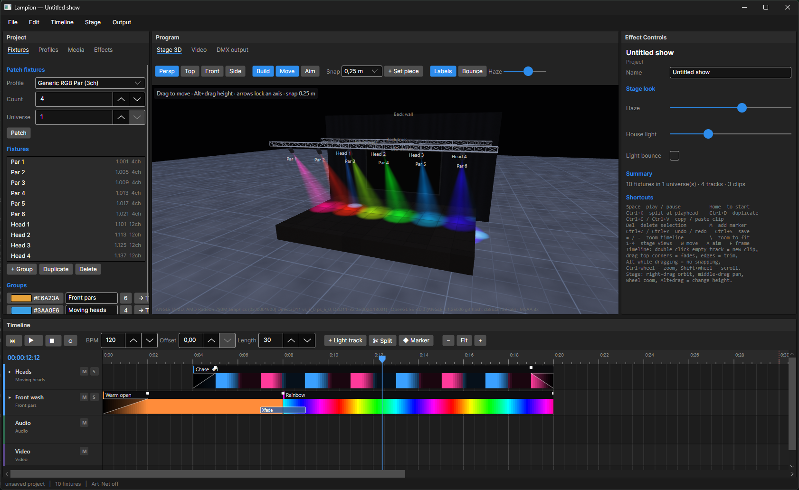

<div align="center">

# 🏮 Lampion

**Design light shows on a timeline, see them in real 3D, and send them to QLC+.**

[](https://github.com/arukosakai/lampion/actions/workflows/release.yml)
[](https://github.com/arukosakai/lampion/releases)


[](LICENSE)



</div>

You patch your DMX fixtures, build the venue in metres, and lay your lights out on an After Effects-style timeline next to the music and video. Lampion previews the show live in GPU-rendered 3D, works out every DMX value itself, and exports a ready-to-run QLC+ workspace.

---

## ✨ Highlights

<table>
<tr>
<td width="50%" valign="top">

### 🎬 Timeline editing
- Light, audio and video tracks, with a beat grid driven by BPM and offset
- Drag, trim, split (<kbd>Ctrl</kbd>+<kbd>K</kbd>), duplicate, copy and paste clips
- Fade handles and transitions: crossfade, dip to black, wipe across the rig
- Audio waveforms, markers, and snapping to beats, clip edges and the playhead

</td>
<td width="50%" valign="top">

### 🌈 Effects & automation
- Solid, colour fade, rainbow, colour cycle, chase, strobe, pulse, sparkle, gradient, colour wave, fire, lightning, heartbeat, hit
- Presets: save a clip's whole look (effect, fades, automation) and reuse it in any show; import/export as `.lampfx`
- Keyframe lanes for hue shift, saturation, intensity, opacity and white
- …or drive any channel directly: pan, tilt, strobe, gobo, or a raw channel number
- Tracks stack with Normal, HTP or Add blending

</td>
</tr>
<tr>
<td valign="top">

### 💡 Fixtures & DMX
- Profiles where each channel has a role: dimmer, R/G/B, white, amber, UV, strobe, pan/tilt (16-bit)…
- Lampion maps colour onto whatever channels each fixture actually has
- Auto-addressing, overlap warnings, groups, and a live 512-channel monitor
- Art-Net output so a real rig follows along

</td>
<td valign="top">

### 🏟️ Real-time 3D stage
- OpenGL rendering: per-pixel spotlights, volumetric beams in moving haze, lens flares
- A stage builder in metres: truss, risers, walls and LED screens that play your video
- A Unity-style scene gizmo for axis views and ortho, move gizmos, grid snapping, an aim tool, and throw and spot-size readouts
- Stage layouts you save once and reuse in every project

</td>
</tr>
</table>

---

## 📦 Download

Grab the latest build from **[Releases](https://github.com/arukosakai/lampion/releases)**:

| Platform | File | Notes |
| --- | --- | --- |
| Windows (x64 / ARM64) | `Lampion-*-win-x64.zip` / `win-arm64.zip` | Unzip and run `Lampion.exe` |
| macOS (Apple Silicon / Intel) | `Lampion-*-osx-arm64.zip` / `osx-x64.zip` | Not notarized: right-click → **Open** the first time, or run `xattr -cr Lampion.app` |
| Linux (x64) | `Lampion-*-linux-x64.tar.gz` | Needs the system libvlc for audio/video (`sudo apt install vlc`) |

Every build is self-contained, so there's no .NET to install.

---

## 🚀 Quick tour

1. **Start:** Lampion opens on a start screen with your recent shows, a blank show, the demo, and templates (built-in venues plus any you save with **Stage → Save layout as template…**).
2. **Patch:** in the **Project** panel, **＋ New → Fixtures…** opens a New Fixtures dialog: pick a profile, how many, where to hang them, and Lampion addresses and groups them for you.
3. **Build the stage:** in **Stage 3D**, drag fixtures and set pieces around; **+ Set piece** adds truss, risers, walls or screens. Everything is in metres.
4. **Add music:** **File → Import audio…**, then set the **BPM** and **Offset** so the beat grid lines up with the song.
5. **Light it:** drag a group from the **Project** panel onto the timeline for a light track, then drag effects and transitions from the **Effects** panel onto it. In **Effect Controls**, scrub the blue values and click a ⏱ stopwatch to keyframe a property at the playhead, just like After Effects.
6. **Export:** **File → Export to QLC+…** writes a `.qxw` workspace. Open it in QLC+ and play the show from the Show Manager.

> 💡 Templates and **Stage → Use this layout as the default** start new shows with your venue and rig already patched, with a light track for each group. <kbd>Ctrl</kbd>+<kbd>N</kbd> brings the start screen back at any time.

---

## 🧠 How colour becomes DMX

Effects and colour automation produce *light* (colour × intensity). Each fixture's profile decides how that lands on its channels:

| Fixture has… | Lampion sends |
| --- | --- |
| R, G, B | the colour, scaled by intensity |
| a dimmer | full-saturation RGB, with the dimmer carrying the level |
| a white channel | the part R, G and B share, moved onto white (can be switched off per fixture) |
| no colour channels | brightness on the dimmer; the preview shows the fixture's gel colour |

The 3D preview is drawn **from the computed DMX**, decoded back into light, so what you see is exactly what gets sent.

---

## 🎛️ QLC+ export

- Each fixture is patched at its address. RGB/RGBW profiles become QLC+ **RGB panels**; everything else becomes **Generic**.
- Each group gets a **Sequence** holding the exact rendered DMX, reduced to linear fades within a tolerance you choose.
- One **Show** plays the sequences alongside **Audio** and **Video** functions at their timeline positions.
- It can **merge into an existing workspace**: fixtures at the same address are reused, overlaps are skipped with a warning, and IDs and names never collide.

---

## ⌨️ Shortcuts

| Keys | Action | Keys | Action |
| --- | --- | --- | --- |
| <kbd>Space</kbd> | Play / pause | <kbd>Ctrl</kbd>+<kbd>K</kbd> | Split at playhead |
| <kbd>Home</kbd> / <kbd>End</kbd> | Start / end | <kbd>Ctrl</kbd>+<kbd>D</kbd> | Duplicate |
| <kbd>←</kbd> / <kbd>→</kbd> | Step a frame (<kbd>Shift</kbd>: 1 s) | <kbd>Del</kbd> | Delete selection |
| <kbd>M</kbd> | Add marker | <kbd>Ctrl</kbd>+<kbd>Z</kbd> / <kbd>Y</kbd> | Undo / redo |
| <kbd>=</kbd> / <kbd>-</kbd> / <kbd>\\</kbd> | Zoom in / out / fit | <kbd>Ctrl</kbd>+<kbd>S</kbd> | Save |
| <kbd>1</kbd>–<kbd>5</kbd> | Persp / top / front / right / toggle ortho | <kbd>Ctrl</kbd>+<kbd>E</kbd> | Export to QLC+ |
| <kbd>Q</kbd> / <kbd>W</kbd> / <kbd>A</kbd> | Hand / move / aim tool | <kbd>F</kbd> | Frame selection |
| | | <kbd>Ctrl</kbd>+<kbd>Shift</kbd>+<kbd>P</kbd> | Project settings |

**Stage:** right-drag to orbit, middle-drag to pan, scroll to zoom, <kbd>Alt</kbd>+drag to change height.
**Timeline:** double-click an empty track for a new clip, <kbd>Ctrl</kbd>+scroll to zoom, <kbd>Alt</kbd> while dragging to turn snapping off.

---

## 🛠️ Building from source

Requires the [.NET 10 SDK](https://dotnet.microsoft.com/download).

```sh
dotnet run --project src/Lampion.App              # opens the start screen
dotnet run --project src/Lampion.App -- my.lampion
dotnet test                                       # engine tests
```

| Project | Contents |
| --- | --- |
| `src/Lampion.Core` | Model, show evaluator, DMX mapping, QLC+ export, Art-Net, stage layouts. No UI dependencies. |
| `src/Lampion.App` | Avalonia UI, the OpenGL stage renderer and LibVLC media playback |
| `tests/Lampion.Core.Tests` | xUnit tests for the engine and the exporter |

### Releasing

Push a version tag and GitHub Actions takes care of the rest:

```sh
git tag v0.1.0 && git push origin v0.1.0
```

The [release workflow](.github/workflows/release.yml) runs the tests, then builds self-contained packages for Windows, macOS and Linux and attaches them to a GitHub release. Tags with a suffix like `v0.2.0-beta.1` become pre-releases.

---

<div align="center">
<sub>Released into the public domain under the <a href="LICENSE">Unlicense</a>.</sub>
</div>
