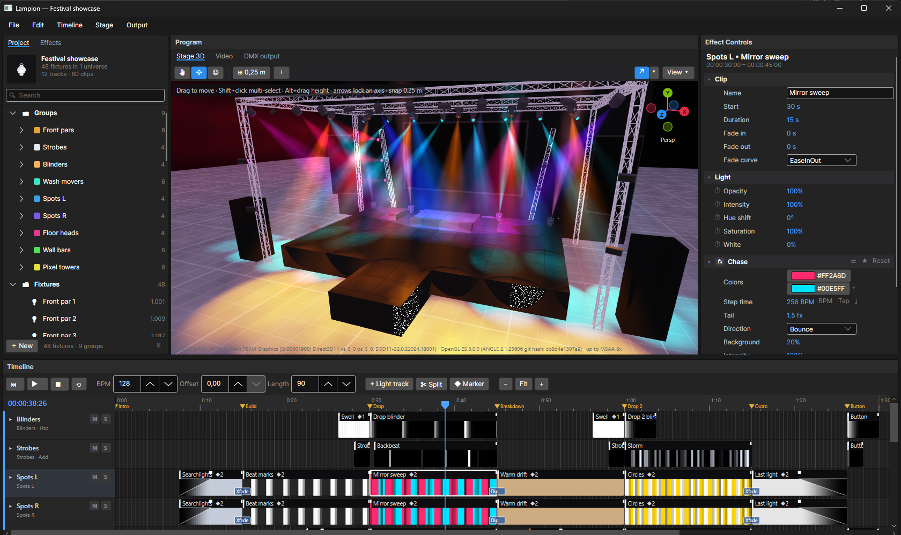

<div align="center">

# 🏮 Lampion

**Design light shows on a timeline, see them in real 3D, send them to QLC+ or run them live.**

[](https://github.com/arukosakai/lampion/actions/workflows/release.yml)
[](https://github.com/arukosakai/lampion/releases)


[](LICENSE)



</div>

You patch your DMX fixtures, build the venue in metres, and lay your lights out on an After Effects-style timeline next to the music and video. Lampion previews the show live in GPU-rendered 3D, works out every DMX value itself, and exports a ready-to-run QLC+ workspace. On show night, the live console plays a set list of your shows in sync with the music, with faders, effect pads and a MIDI controller on top.

---

## ✨ Highlights

<table>
<tr>
<td width="50%" valign="top">

### 🎬 Timeline editing
- Light, audio and video tracks, with a beat grid driven by BPM and offset
- Drag, trim, split (<kbd>Ctrl</kbd>+<kbd>K</kbd>), duplicate, copy and paste clips; grabbing a clip edge puts the playhead on it
- Compact tracks to fit more on screen: double-click a track header, or compact them all from the transport bar or Timeline menu
- Fade handles and transitions: crossfade, dip to black, wipe across the rig
- Markers: the playhead snaps to them while scrubbing (Alt scrubs freely); Ctrl+click or right-click one to delete it
- Audio waveforms, plus clips snapping to beats, markers, clip edges and the playhead (the stopped playhead wins when it's in reach, then the end of the previous clip on the track; hold Alt to drag freely)

</td>
<td width="50%" valign="top">

### 🌈 Effects & automation
- Solid, colour fade, rainbow, colour cycle, chase (with an offset to run tracks out of step), strobe, pulse, sparkle, gradient, colour wave, fire, lightning, heartbeat, hit (one colour or a new one every hit), and Morse code blinking any text you type
- Presets: save a clip's whole look (effect, fades, automation) and reuse it in any show; import/export as `.lampfx`
- Keyframe lanes for hue shift, saturation, intensity, opacity and white
- Animate any numeric effect parameter (sparkle rate, chase step time, strobe duty, decay, ...) with its ⏱ stopwatch; keyframed speeds ramp smoothly instead of jumping, and a split clip carries on exactly where it was
- Colour inputs open a picker with a colour wheel, a new/original preview (click the original to go back), HSB sliders, hex and presets
- …or drive any channel directly: pan, tilt, strobe, gobo, or a raw channel number
- Tracks stack with Normal, HTP or Add blending

</td>
</tr>
<tr>
<td valign="top">

### 💡 Fixtures & DMX
- Profiles where each channel has a role: dimmer, R/G/B, white, amber, UV, strobe, pan/tilt (16-bit)…
- Lampion maps colour onto whatever channels each fixture actually has
- Auto-addressing, overlap warnings, groups, and a live 512-channel monitor
- Live DMX output so a real rig follows along: Art-Net, or a USB interface (Enttec DMX USB Pro and compatibles, Open DMX / FTDI cables), picked in **Output → Output setup…**

</td>
<td valign="top">

### 🏟️ Real-time 3D stage
- OpenGL rendering: per-pixel spotlights, volumetric beams in moving haze, lens flares
- A stage builder in metres: truss (lying, standing as towers, or built into arches and cubes with lights), risers, walls and LED screens that play your video; every set piece and fixture can be yawed, pitched and rolled
- A Unity-style scene gizmo for axis views and ortho, move gizmos, grid snapping, an aim tool, and throw and spot-size readouts
- Stage layouts you save once and reuse in every project

</td>
</tr>
<tr>
<td valign="top">

### 🎚️ Live console
- A set list of shows, cut to with **GO**, with the song as the master clock for the lights
- Faders for intensity, colour or any channel, and launchpad-style effect pads that can fire sound effects
- MIDI learn, plus one-click mapping for the Akai APC mini mk2 with lit pads
- A 100 Hz engine on its own thread, built to keep running through errors on show night

</td>
<td valign="top">

### 🎵 Music & video
- Audio and video clips on the timeline, with waveforms and a beat grid to edit against
- MP3s are conformed to WAV in the background so playback starts on the right spot anywhere in the song
- LED screens on the stage play your video
- The QLC+ export brings the audio and video along at their timeline positions

</td>
</tr>
</table>

---

## 📦 Download

Grab the latest build from **[Releases](https://github.com/arukosakai/lampion/releases)**:

| Platform | File | Notes |
| --- | --- | --- |
| Windows (x64 / ARM64) | `Lampion-*-win-x64.zip` / `win-arm64.zip` | Unzip and run `Lampion.exe` |
| macOS (Apple Silicon / Intel) | `Lampion-*-osx-arm64.zip` / `osx-x64.zip` | Not notarized: right-click → **Open** the first time, or run `xattr -cr Lampion.app` |
| Linux (x64) | `Lampion-*-linux-x64.tar.gz` | Needs the system libvlc for audio/video (`sudo apt install vlc`) |

Every build is self-contained, so there's no .NET to install.

---

## 🚀 Quick tour

1. **Start:** Lampion opens on a start screen with your recent shows, a blank show, the short demo, the **festival showcase** (a 90 s, 128 bpm show on a 48-fixture festival rig that uses every effect, transition, blend mode and automation target), and templates (built-in venues, including the showcase's **Festival stage**, plus any you save with **Stage → Save layout as template…**).
2. **Patch:** in the **Project** panel, **＋ New → Fixtures…** opens a New Fixtures dialog: pick a profile, how many, where to hang them, and Lampion addresses and groups them for you.
3. **Build the stage:** in **Stage 3D**, drag fixtures and set pieces around; **+ Set piece** adds truss, truss towers, risers, walls or screens, and **Stage → Truss structure…** puts up a whole arch (goalpost) or truss cube with lights already patched and hung on its spans. **+ Set piece → 3D model…** (or **Stage → Import 3D model…**, or dropping the file on the window) brings in your own glTF (.glb, .gltf) or OBJ model with its textures, lit by the rig; it's copied into a *Show Name* Assets folder next to the show file, so keep the two together when you move the show. Shift+click adds to or removes from the selection, and the move gizmo sits at the centre of everything selected. A structure moves as one (drag any piece; Ctrl+drag moves just that piece), and its Effect Controls can move, turn, ungroup or delete it. Everything is in metres; Effect Controls has yaw, pitch and roll for any set piece, and roll for fixtures (90° side-mounts a moving head or stands a batten upright).
4. **Add music:** **File → Import audio…** or drag audio and video files onto the window (they land at the playhead), then set the **BPM** and **Offset** so the beat grid lines up with the song. MP3s are conformed in the background to a WAV copy (kept in the local app data's `Lampion/Audio Proxies`, safe to delete) so playback starts in the right place from anywhere in the song.
5. **Light it:** drag a group from the **Project** panel onto the timeline for a light track, then drag effects and transitions from the **Effects** panel onto it. In **Effect Controls**, scrub the blue values and click a ⏱ stopwatch to keyframe a property at the playhead, just like After Effects. Timing values (rates, speeds, step times, the Hit interval) can be shown in their own unit or in **BPM** (click the unit), set by clicking **Tap** along to the beat, or matched to the show's tempo with **♩**.
6. **Export:** **File → Export to QLC+…** writes a `.qxw` workspace. Open it in QLC+ and play the show from the Show Manager.

> 💡 Templates and **Stage → Use this layout as the default** start new shows with your venue and rig already patched, with a light track for each group. <kbd>Ctrl</kbd>+<kbd>N</kbd> brings the start screen back at any time.

---

## 🧠 How colour becomes DMX

Effects and colour automation produce *light* (colour × intensity). Each fixture's profile decides how that lands on its channels:

| Fixture has… | Lampion sends |
| --- | --- |
| R, G, B | the colour, scaled by intensity |
| a dimmer | full-saturation RGB, with the dimmer carrying the level |
| a white channel | the part R, G and B share, moved onto white (can be switched off per fixture) |
| no colour channels | brightness on the dimmer; the preview shows the fixture's gel colour |

The 3D preview is drawn **from the computed DMX**, decoded back into light, so what you see is exactly what gets sent.

---

## 🎛️ QLC+ export

- Each fixture is patched at its address. RGB/RGBW profiles become QLC+ **RGB panels**; everything else becomes **Generic**.
- Each group gets a **Sequence** holding the exact rendered DMX, reduced to linear fades within a tolerance you choose.
- One **Show** plays the sequences alongside **Audio** and **Video** functions at their timeline positions.
- It can **merge into an existing workspace**: fixtures at the same address are reused, overlaps are skipped with a warning, and IDs and names never collide.

---

## 🎚️ Live console (preview)

**Output → Live console…** (<kbd>Ctrl</kbd>+<kbd>L</kbd>) turns the project into a live rig:

- **Set list:** other Lampion shows (or this project's own timeline). **GO** cuts to the selected one. Show fixtures are matched to the rig by id, then by universe and address.
- **Music in sync:** the show's audio plays and is the master clock. The lights hold the first frame while the song buffers, start with it, then follow its position: small drift is slewed away (up to ±5 % speed), so there are no visible jumps. **Light delay (ms)** makes up for the PA's latency.
- **Faders:** intensity, hue, saturation or any channel role of some fixtures, or the intensity, speed or hue of a pad. Faders only reach fixtures the playing show doesn't drive, and a strip says when the show holds its fixtures.
- **Pads:** launchpad-style buttons that start and stop an effect (toggle or flash), lit while on. If the controller has an output, its pad LEDs light up too. A pad can also play a sound effect (Edit → **Sound**): it plays from the start each time the pad switches on, at its own volume, and either plays out or stops with the pad. Sounds are kept buffered, so a press sounds straight away.
- **Widgets:** a column for a wall clock and photos (+ Widget; right-click to change or remove). Display only.
- **Save console… / Load console…:** take a whole console (set list, faders, pads, MIDI mappings, widgets) to another project as a `.lamplive` file. Fixtures are matched by universe and address, groups by name, and anything that can't be matched is listed. Loading is one undo step.
- **MIDI:** right-click a fader or pad → Edit → **Learn**, then move a slider or hit a pad. Windows only for now.
- **MIDI set list:** under the set list, **MIDI buttons** learns a button for GO, Stop and each show. The buttons light while their show plays, blink while it loads, and Stop/GO light when there's something to stop or go to.
- **Akai APC mini mk2:** plugged in, it connects by itself when the live console opens (picking any controller as input also picks its matching output). **Map to APC mini mk2** binds faders 1–9 to its faders, the first 64 pads to the grid (top row first), shows 1–7 to scene buttons 1–7, Stop to the bottom scene button and GO to the rightmost track button. Pads light in their effect's colour: dim while off, full while on. Undoable, and every binding can still be re-learned.
- Rendering runs on its own high-priority thread at 100 Hz and doesn't allocate per frame. The UI only displays it, so the 3D stage and DMX monitor follow the live output, and frames go straight from the engine to the DMX device.
- **Built for show night:** a broken pad is switched off and a show that fails holds its last look, instead of the frame (or the app) going down. Background threads (engine, DMX sender, MIDI, audio) survive any error, and unexpected UI errors are reported instead of quitting. Quitting or opening another project mid-show asks first. Windows stays awake, the process runs at high priority, and an unplugged MIDI controller reconnects by itself. Fuzz tests throw garbage MIDI, nonsense settings and broken timing at the engine. See [docs/SHOW-DAY.md](docs/SHOW-DAY.md) for what to check before a show.

---

## ⌨️ Shortcuts

| Keys | Action | Keys | Action |
| --- | --- | --- | --- |
| <kbd>Space</kbd> | Play / pause | <kbd>Ctrl</kbd>+<kbd>K</kbd> | Split at playhead |
| <kbd>Home</kbd> / <kbd>End</kbd> | Start / end | <kbd>Ctrl</kbd>+<kbd>D</kbd> | Duplicate |
| <kbd>←</kbd> / <kbd>→</kbd> | Step a frame (<kbd>Shift</kbd>: 1 s) | <kbd>Del</kbd> | Delete selection |
| <kbd>M</kbd> / <kbd>J</kbd> / <kbd>K</kbd> | Add marker / previous / next marker | <kbd>Ctrl</kbd>+<kbd>Z</kbd> / <kbd>Y</kbd> | Undo / redo |
| <kbd>=</kbd> / <kbd>-</kbd> / <kbd>\\</kbd> | Zoom in / out / fit | <kbd>Ctrl</kbd>+<kbd>S</kbd> | Save |
| <kbd>1</kbd>–<kbd>5</kbd> | Persp / top / front / right / toggle ortho | <kbd>Ctrl</kbd>+<kbd>E</kbd> | Export to QLC+ |
| <kbd>Q</kbd> / <kbd>W</kbd> / <kbd>A</kbd> | Hand / move / aim tool | <kbd>F</kbd> | Frame selection |
| <kbd>Ctrl</kbd>+<kbd>L</kbd> | Live console | <kbd>Ctrl</kbd>+<kbd>Shift</kbd>+<kbd>P</kbd> | Project settings |
| <kbd>Ctrl</kbd>+<kbd>G</kbd> | Go to time (or click the timecode) | | |

**Stage:** right-drag to orbit, middle-drag to pan, scroll to zoom, <kbd>Alt</kbd>+drag to change height.
**Timeline:** click the timecode to type a time (`1:30`, `00:01:30:15`, `90.5`, or `+5` / `-2` from the playhead), double-click an empty track for a new clip, double-click a track header to make it compact, <kbd>Ctrl</kbd>+scroll to zoom, <kbd>Alt</kbd> while dragging to turn snapping off.

---

## 🛠️ Building from source

Requires the [.NET 10 SDK](https://dotnet.microsoft.com/download).

```sh
dotnet run --project src/Lampion.App              # opens the start screen
dotnet run --project src/Lampion.App -- my.lampion
dotnet test                                       # engine tests
```

| Project | Contents |
| --- | --- |
| `src/Lampion.Core` | Model, show evaluator, DMX mapping, QLC+ export, Art-Net and USB DMX output, the live engine and MIDI, stage layouts, 3D model import (glTF/OBJ). No UI dependencies. |
| `src/Lampion.App` | Avalonia UI, the live console window, the OpenGL stage renderer and LibVLC media playback |
| `tests/Lampion.Core.Tests` | xUnit tests for the engine, the exporter, the live engine and MIDI, including fuzz and allocation tests |

### Releasing

Push a version tag and GitHub Actions takes care of the rest:

```sh
git tag v0.1.0 && git push origin v0.1.0
```

The [release workflow](.github/workflows/release.yml) runs the tests, then builds self-contained packages for Windows, macOS and Linux and attaches them to a GitHub release. Tags with a suffix like `v0.2.0-beta.1` become pre-releases.

---

<div align="center">
<sub>Released into the public domain under the <a href="LICENSE">Unlicense</a>.</sub><br>
<sub>Icons from <a href="https://lucide.dev">Lucide</a> (ISC licence, see <code>src/Lampion.App/Controls/Icons/LUCIDE-LICENSE.txt</code>).</sub>
</div>
